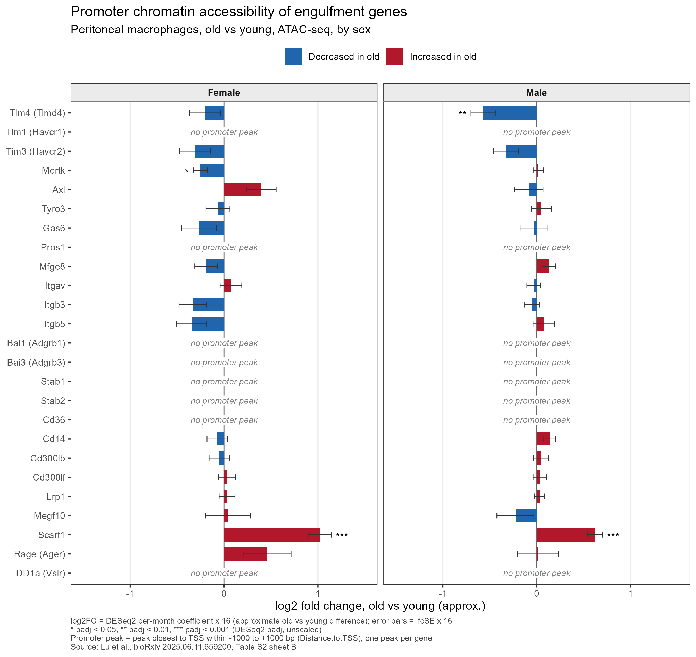
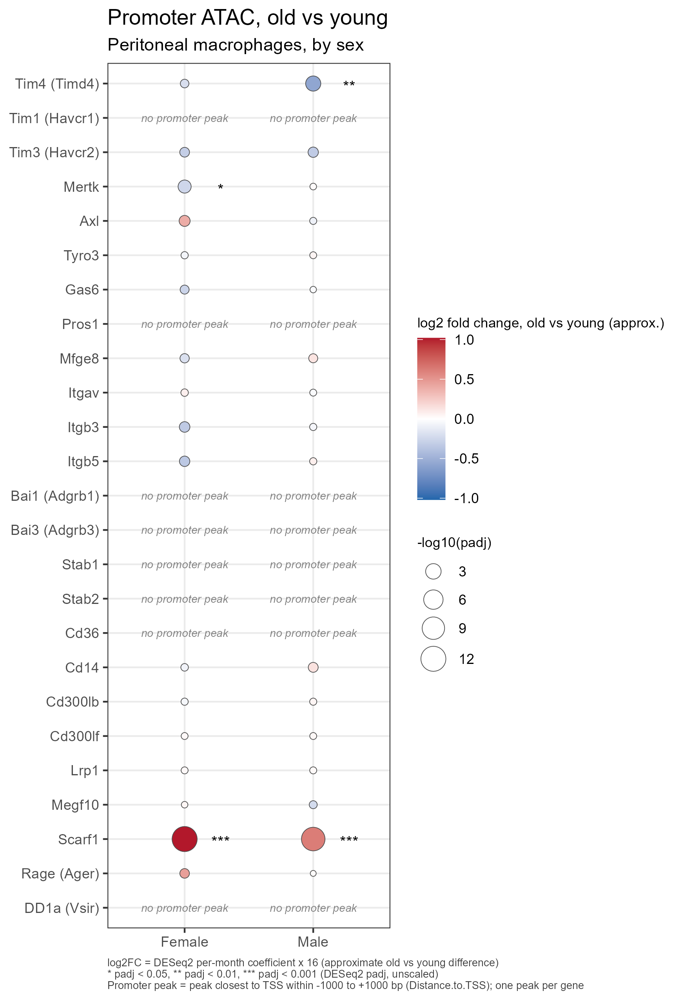

# 나이 든 쥐의 복강 대식세포에서 engulfment 유전자 promoter의 열림 정도 변화 (ATAC-seq)

> **한 줄 요약**: 공개된 ATAC-seq 결과표로 젊은 쥐와 늙은 쥐의 복강 대식세포에서 Tim4 등 "죽은 세포를 먹는 데 관여하는 유전자" 25개의 promoter(유전자 스위치 부위)가 얼마나 열려 있는지 암컷·수컷 따로 비교했고, Tim4 promoter는 수컷에서만 늙은 쥐에서 유의하게 덜 열려 있었습니다.

---

## 목차

1. [연구 질문](#1-연구-질문)
2. [데이터 출처](#2-데이터-출처)
3. [용어 풀이](#3-용어-풀이)
4. [분석 방법](#4-분석-방법)
5. [결과](#5-결과)
6. [해석할 때 주의할 점](#6-해석할-때-주의할-점)
7. [재현 방법](#7-재현-방법)
8. [인용](#8-인용)
9. [라이선스](#9-라이선스)
10. [저장소 구성](#10-저장소-구성)

---

## 1. 연구 질문

몸속에서는 매일 수많은 세포가 죽고, 대식세포(macrophage)가 이 죽은 세포를 삼켜서 치웁니다. 이렇게 세포를 삼키는 과정을 **engulfment**라고 부릅니다. Tim4(유전자 이름 *Timd4*)는 죽은 세포 표면에 드러나는 "나를 치워 달라"는 표지(phosphatidylserine)를 알아보는 수용체로 알려져 있습니다(Miyanishi et al., *Nature* 2007).

이 저장소가 묻는 질문은 다음과 같습니다.

> **나이가 들면, 복강(배 안 공간) 대식세포에서 Tim4 등 engulfment 관련 유전자의 조절 부위(promoter)가 더 열리거나 더 닫히는가?**

비교한 유전자는 engulfment 관련 유전자로 고른 25개입니다. 괄호 안은 데이터 파일에 쓰인 공식 유전자 기호입니다.

Tim4 (*Timd4*), Tim1 (*Havcr1*), Tim3 (*Havcr2*), *Mertk*, *Axl*, *Tyro3*, *Gas6*, *Pros1*, *Mfge8*, *Itgav*, *Itgb3*, *Itgb5*, Bai1 (*Adgrb1*), Bai3 (*Adgrb3*), *Stab1*, *Stab2*, *Cd36*, *Cd14*, *Cd300lb*, *Cd300lf*, *Lrp1*, *Megf10*, *Scarf1*, Rage (*Ager*), DD1a (*Vsir*)

## 2. 데이터 출처

| 항목 | 내용 |
|---|---|
| 논문 | Lu et al., *Murine peritoneal macrophages undergo female-specific remodeling with aging*, bioRxiv 2025.06.11.659200 (preprint) |
| 원본 시퀀싱 데이터 | NCBI BioProject PRJNA1095555 |
| 사용한 표 | Supplementary Table S2 (`media-3.xlsx`) sheet B: ATAC-seq peak별 DESeq2 결과 |
| 쥐 | C57BL/6JNia, 복강 대식세포 |
| 비교 | young vs old, **암컷과 수컷을 각각 따로** 분석 |
| 나이 | 논문 본문: young 4-5개월, old 20-21개월 / Table S1 계산값: young 6.54개월, old 22.57개월 (아래 참고, 불일치는 확인 필요) |
| 마릿수 | 성별·나이 그룹당 5마리 (Table S1 기준; 모두 DESeq2 분석에 쓰였는지는 확인 필요) |

**중요: 이 저장소는 raw data(원본 시퀀싱 데이터)를 다시 분석하지 않았습니다.** 원 논문 저자들이 DESeq2라는 통계 프로그램으로 계산해 공개한 결과표를 그대로 가져와, 관심 있는 유전자만 골라 정리하고 그림을 그렸습니다. 따라서 모든 숫자(변화량, p값 등)는 원 논문의 계산 결과입니다.

**나이에 대해**: 쥐의 나이는 두 가지 기준이 있고, 서로 일치하지 않습니다.

| 기준 | young | old | 두 그룹 차이 |
|---|---|---|---|
| 논문 본문 표기 | 4-5개월 | 20-21개월 | 약 16개월 |
| Table S1 계산값 (ATAC-seq 실험 쥐 20마리의 생년월일·안락사일로 계산) | 6.54개월 | 22.57개월 | 16.03개월 |

- 두 값이 왜 다른지는 **확인 필요**입니다.
- 어느 기준이든 두 그룹의 차이는 약 16개월이므로, 아래의 ×16 환산과 p값·padj에는 영향이 없습니다.
- Table S1 계산 방법은 [`data/README_data.md`](data/README_data.md)에 있습니다.
- 그림과 결과 파일에는 나이 숫자를 넣지 않고 "old vs young"으로만 표기했습니다.

## 3. 용어 풀이

#### ATAC-seq

세포의 DNA 중 어느 부분이 "열려 있는지"를 찾는 실험입니다. 세포핵 속 DNA는 실이 실패에 감기듯 단백질에 촘촘히 감겨 있고, 일부만 느슨하게 풀려 있습니다. ATAC-seq는 풀린 부분만 자를 수 있는 효소를 넣은 뒤, 잘린 조각을 읽어서 "어디가 풀려 있었는지" 지도를 만듭니다.

#### chromatin accessibility (염색질 접근성, 열린 정도)

DNA가 얼마나 풀려 있어서 다른 단백질이 접근할 수 있는지를 뜻합니다. 책에 비유하면, 펼쳐진 페이지는 읽을 수 있고 덮인 페이지는 읽을 수 없는 것과 비슷합니다. 유전자 스위치 부위가 열려 있으면 그 유전자를 켤 준비가 되어 있을 가능성이 높다고 봅니다. 다만 열려 있다고 해서 실제로 켜져 있다는 뜻은 아닙니다([주의할 점](#6-해석할-때-주의할-점) 참고).

#### peak

ATAC-seq 신호가 많이 몰린 DNA 구간, 즉 "열린 구역" 하나를 말합니다. 원 논문의 결과표는 7만 개가 넘는 peak 각각에 대해 "나이가 들면 이 구역이 더 열리는가/닫히는가"를 계산해 둔 것입니다. 각 peak에는 가장 가까운 유전자 이름이 하나 붙어 있습니다(이를 annotation이라고 합니다).

#### promoter

유전자 바로 앞(시작점 근처)에 있는 조절 부위로, 유전자의 "전원 스위치"에 해당합니다.

#### TSS (transcription start site, 전사 시작 지점)

유전자가 RNA로 읽히기 시작하는 위치입니다. 이 분석에서는 TSS 앞뒤 1,000 bp(염기쌍) 안을 promoter로 정의했습니다. 결과표의 "TSS 거리"는 peak이 TSS에서 얼마나 떨어져 있는지를 나타냅니다.

#### log2 fold change (log2FC)

늙은 쥐가 젊은 쥐에 비해 몇 배인지를 log2로 나타낸 값입니다.

`0` = 변화 없음, `+1` = 2배, `-1` = 절반(0.5배), `+2` = 4배, `-0.5` = 약 0.71배

양수(+)면 늙은 쥐에서 **더 열림**, 음수(−)면 늙은 쥐에서 **덜 열림**입니다. 이해를 돕기 위해 아래 결과표에는 배수(2^log2FC)도 함께 적었습니다.

#### lfcSE

log2FC 추정값의 불확실성(표준오차)입니다. 막대그래프의 오차막대 길이가 이 값입니다.

#### p값과 padj (FDR)

p값은 "실제로는 차이가 없는데 우연히 이 정도 차이가 관찰될 확률"에 가까운 값입니다. 그런데 peak 7만여 개를 한꺼번에 검사하면, 순전히 우연으로 p값이 작게 나오는 peak이 많이 생깁니다. 복권을 7만 장 사면 몇 장은 당첨되는 것과 같습니다. **padj**는 이 점을 보정한 값입니다(DESeq2의 기본 보정 방법은 Benjamini-Hochberg FDR). 이 분석에서는 **padj < 0.05**를 "유의하다"고 판단했습니다. 대략 "유의하다고 고른 결과들 가운데 거짓 양성이 평균 5% 이하가 되도록" 정한 기준입니다.

별표: `*` padj < 0.05, `**` padj < 0.01, `***` padj < 0.001

#### DESeq2

시퀀싱으로 센 read 개수를 그룹 간에 비교하는 데 널리 쓰이는 통계 프로그램입니다. 원 논문 저자들이 이것으로 peak마다 log2FC, lfcSE, p값, padj를 계산했습니다.

## 4. 분석 방법

### 4-1. 유전자마다 대표 peak을 1개씩 고름

한 유전자 주변에는 peak이 여러 개 있을 수 있습니다(예: *Timd4*에 붙은 peak은 13개). 이 분석에서는 유전자마다 **TSS ±1,000 bp 안에 있는 peak 중 TSS에 가장 가까운 것 1개**를 그 유전자의 promoter peak으로 정했습니다.

**가장 유의한 peak을 고르지 않은 이유**

- **우연히 유의한 peak이 뽑힐 위험**: 유전자마다 여러 peak 중 p값이 가장 작은 것을 고르면, peak이 많은 유전자일수록 순전히 우연으로 "유의한" 결과가 나오기 쉽습니다. 주사위를 여러 번 던져 가장 높은 눈만 보고하는 것과 비슷합니다.
- **결과를 보고 기준을 정하는 편향**: 결과를 먼저 보고 원하는 peak을 고르면, 분석하는 사람의 기대가 결과에 섞입니다.
- **거리 기준은 결과와 무관함**: "TSS에 가장 가까운 peak"은 결과를 보기 전에 정할 수 있는 기준이라, 모든 유전자에 똑같이 적용됩니다. 또 이 기준은 성별과 무관하므로, 암컷과 수컷 비교에 **같은 peak**이 쓰입니다.

25개 유전자 중 **17개**는 promoter peak이 있었고, **8개**(*Havcr1*, *Pros1*, *Adgrb1*, *Adgrb3*, *Stab1*, *Stab2*, *Cd36*, *Vsir*)는 ±1,000 bp 안에 peak이 없었습니다. 이 유전자들은 그림에 "no promoter peak"로 표시했습니다.

### 4-2. "1개월당 변화량"을 "old vs young 차이"로 환산 (×16)

원 논문의 DESeq2 결과는 old와 young을 직접 비교한 값이 아니라, **"나이 1개월당 log2FC"** 형태로 되어 있습니다. 이 값만으로는 크기를 가늠하기 어려우므로, 두 그룹의 나이 차이(논문 본문 기준 약 16개월, Table S1 계산값 16.03개월로 두 기준 모두 약 **16개월**)를 곱해 "old vs young 차이"의 근사값으로 바꿨습니다.

```
old vs young log2FC (근사) = 1개월당 log2FC × 16
오차막대 (lfcSE)           = 1개월당 lfcSE × 16
```

- 이 환산은 모든 값에 같은 숫자(16)를 곱하는 것일 뿐이라서, **p값과 padj는 전혀 바뀌지 않습니다.** 유의한지 아닌지도 그대로입니다.
- 원래의 1개월당 값도 결과 표(`results/tables/`)에 함께 저장했습니다.
- 원 논문이 DESeq2에서 나이를 어떤 값으로 넣었는지(정확한 개월 수 등)는 **확인 필요**입니다. 그래서 ×16 값은 **근사값**으로 표시합니다.

### 4-3. 암컷과 수컷을 따로 분석

원 논문은 초록에서 나이 듦에 따른 복강 대식세포의 변화가 **성별에 따라 다르다**(sex-specific remodeling)고 보고했습니다. 원 논문의 결과표도 암컷(`_F`)과 수컷(`_M`)을 따로 계산해 두었습니다. 그래서 이 분석도 두 성별을 합치지 않고 **암컷 old vs young**, **수컷 old vs young** 두 가지로 따로 보여줍니다.

### 4-4. 민감도 분석: promoter 범위를 ±2,000 bp로 넓혀 보기

"±1,000 bp"라는 기준이 결과를 좌우하는지 확인하려고, 범위를 ±2,000 bp로 넓혀 같은 분석을 한 번 더 했습니다([결과 5-5](#5-5-민감도-분석-2000-bp) 참고).

## 5. 결과

### 5-1. 막대그래프



**그림 읽는 법**

- 한 줄이 유전자 하나입니다. 왼쪽 패널은 암컷, 오른쪽 패널은 수컷입니다.
- **막대 방향과 색**: 가운데 세로선(0)을 기준으로 **왼쪽 파란 막대 = 늙은 쥐에서 덜 열림**, **오른쪽 빨간 막대 = 늙은 쥐에서 더 열림**입니다. 막대가 길수록 차이가 큽니다(가로축은 log2FC, ×16 환산값).
- **오차막대**: 막대 끝의 가는 선은 추정값의 불확실성(lfcSE ×16)입니다. 선이 길수록 값이 덜 확실합니다.
- **별표**: padj < 0.05인 경우에만 표시합니다(`*` < 0.05, `**` < 0.01, `***` < 0.001). 별표가 없으면 막대가 길어 보여도 통계적으로 유의하지 않습니다.
- **no promoter peak**: 그 유전자에는 TSS ±1,000 bp 안에 peak이 없어 값을 표시할 수 없다는 뜻입니다.

### 5-2. 점 그래프 (dotplot)



**그림 읽는 법**

- 가로는 성별(Female = 암컷, Male = 수컷), 세로는 유전자입니다.
- **점 색**: 파란색 = 늙은 쥐에서 덜 열림, 빨간색 = 더 열림, 흰색에 가까울수록 변화가 거의 없음. 색이 진할수록 차이가 큽니다.
- **점 크기**: −log10(padj)입니다. 점이 클수록 padj가 작다(더 확실하다)는 뜻입니다. 예를 들어 padj = 0.05면 약 1.3, padj = 0.001이면 3입니다.
- **별표**와 **no promoter peak**의 의미는 막대그래프와 같습니다.

### 5-3. Tim4 (*Timd4*) 결과

사용한 promoter peak: `chr11:46810158-46812849`, TSS에서 +704 bp (결과표의 annotation 표기: intron (NM_178759, intron 1 of 8))

결과표의 annotation에는 intron(유전자 안쪽 구간)으로 적혀 있지만, 이 분석은 annotation 이름이 아니라 **TSS와의 거리(±1,000 bp)만으로** promoter peak을 정했습니다.

| 성별 | log2FC (old vs young, x16) | 배수로 환산 (2^log2FC) | 원 논문 값 (1개월당) | lfcSE x16 | padj | 유의성 |
|---|---|---|---|---|---|---|
| 암컷 | -0.204 | 0.87 | -0.0127 | 0.164 | 0.58 | n.s. |
| 수컷 | -0.571 | 0.67 | -0.0357 | 0.129 | 0.0016 | ** |

- **수컷**: 늙은 쥐에서 Tim4 promoter가 덜 열려 있었고, 통계적으로 유의했습니다.
- **암컷**: 늙은 쥐에서 값이 약간 낮았지만 통계적으로 유의하지 않았습니다(n.s. = not significant).
- 원본 값: [`results/tables/Tim4_summary.txt`](results/tables/Tim4_summary.txt)

### 5-4. 패널에서 유의한 유전자 (padj < 0.05)

| 유전자 | 성별 | log2FC (x16) | 배수 (2^log2FC) | padj | 유의성 | 방향 |
|---|---|---|---|---|---|---|
| Tim4 (Timd4) | 수컷 | -0.571 | 0.67 | 0.0016 | ** | old에서 감소 |
| Mertk | 암컷 | -0.254 | 0.84 | 0.021 | * | old에서 감소 |
| Scarf1 | 암컷 | 1.018 | 2.03 | 8.0e-13 | *** | old에서 증가 |
| Scarf1 | 수컷 | 0.620 | 1.54 | 5.3e-11 | *** | old에서 증가 |

- *Scarf1*은 암컷과 수컷 모두에서 늙은 쥐의 promoter가 더 열려 있었고, 패널 중 변화가 가장 컸습니다.
- *Mertk*는 암컷에서만 유의하게 덜 열려 있었습니다(수컷은 유의하지 않음).
- Tim4는 수컷에서만 유의했습니다.
- 나머지 유전자는 두 성별 모두 padj ≥ 0.05였습니다.

<details>
<summary>25개 유전자 전체 표 보기</summary>

log2FC는 ×16 환산값(old vs young 근사)입니다.

| 유전자 | TSS 거리 (bp) | 암컷 log2FC | 암컷 padj | 수컷 log2FC | 수컷 padj |
|---|---|---|---|---|---|
| Tim4 (Timd4) | 704 | -0.204 | 0.58  | -0.571 | 0.0016 ** |
| Tim1 (Havcr1) | no promoter peak | - | - | - | - |
| Tim3 (Havcr2) | -103 | -0.307 | 0.33  | -0.325 | 0.23  |
| Mertk | -58 | -0.254 | 0.021 * | 0.017 | 0.95  |
| Axl | 734 | 0.395 | 0.14  | -0.086 | 0.89  |
| Tyro3 | 304 | -0.064 | 0.86  | 0.050 | 0.91  |
| Gas6 | 452 | -0.267 | 0.49  | -0.029 | 0.97  |
| Pros1 | no promoter peak | - | - | - | - |
| Mfge8 | 22 | -0.193 | 0.42  | 0.128 | 0.48  |
| Itgav | 151 | 0.073 | 0.82  | -0.034 | 0.91  |
| Itgb3 | 775 | -0.334 | 0.19  | -0.052 | 0.87  |
| Itgb5 | 289 | -0.347 | 0.22  | 0.076 | 0.87  |
| Bai1 (Adgrb1) | no promoter peak | - | - | - | - |
| Bai3 (Adgrb3) | no promoter peak | - | - | - | - |
| Stab1 | no promoter peak | - | - | - | - |
| Stab2 | no promoter peak | - | - | - | - |
| Cd36 | no promoter peak | - | - | - | - |
| Cd14 | 640 | -0.074 | 0.80  | 0.138 | 0.30  |
| Cd300lb | 473 | -0.051 | 0.87  | 0.046 | 0.89  |
| Cd300lf | -232 | 0.031 | 0.92  | 0.033 | 0.92  |
| Lrp1 | -720 | 0.031 | 0.91  | 0.029 | 0.90  |
| Megf10 | -7 | 0.041 | 0.96  | -0.227 | 0.72  |
| Scarf1 | 417 | 1.018 | 8.0e-13 *** | 0.620 | 5.3e-11 *** |
| Rage (Ager) | 158 | 0.458 | 0.36  | 0.015 | 0.99  |
| DD1a (Vsir) | no promoter peak | - | - | - | - |

</details>

### 5-5. 민감도 분석 (±2,000 bp)

promoter 범위를 ±2,000 bp로 넓히자, ±1,000 bp에서 peak이 없던 유전자 중 4개에 peak이 새로 잡혔습니다. 이미 peak이 있던 유전자들은 선택된 peak이 그대로였습니다.

| 유전자 | ±2kb에서 새로 잡힌 peak의 TSS 거리 (bp) | 암컷 log2FC / padj | 수컷 log2FC / padj |
|---|---|---|---|
| Pros1 | 1389 | -0.040 / 0.87 | -0.036 / 0.87 |
| Bai1 (Adgrb1) | -1761 | 0.761 / 0.24 | 0.042 / 0.98 |
| Cd36 | 1064 | -0.218 / 0.50 | 0.022 / 0.96 |
| DD1a (Vsir) | 1263 | -0.065 / 0.68 | 0.031 / 0.91 |

- 새로 잡힌 peak은 모두 두 성별에서 유의하지 않았습니다.
- **±2,000 bp로 넓혀도 유의한 유전자 목록(*Timd4* 수컷, *Mertk* 암컷, *Scarf1* 암컷·수컷)은 바뀌지 않았습니다.**
- ±2,000 bp에서도 peak이 없는 유전자: *Havcr1*, *Adgrb3*, *Stab1*, *Stab2*
- 전체 비교표: [`results/tables/promoter_window_comparison.csv`](results/tables/promoter_window_comparison.csv)

## 6. 해석할 때 주의할 점

1. **ATAC-seq는 "발현량"이 아니라 "DNA가 열린 정도"를 측정합니다.** promoter가 덜 열려 있다고 해서 그 유전자의 RNA나 단백질이 실제로 줄었다는 뜻은 아닙니다. 발현량은 RNA-seq 같은 다른 실험으로 따로 확인해야 합니다(이 저장소에는 포함하지 않음).
2. **"no promoter peak"는 promoter가 닫혀 있다는 증거가 아닙니다.** 다음과 같은 경우가 모두 포함됩니다.
   - peak이 ±1,000 bp 바로 바깥에 있는 경우 (실제로 ±2,000 bp로 넓히자 *Pros1*, *Adgrb1*, *Cd36*, *Vsir*에서 peak이 잡혔습니다. [5-5](#5-5-민감도-분석-2000-bp) 참고)
   - peak이 있지만 결과표에서 이웃한 **다른 유전자 이름으로 annotation된** 경우 (결과표는 peak마다 가장 가까운 유전자 하나만 붙여 둡니다)
   - 결과표의 annotation이 기준으로 삼은 TSS와 다른 위치에서 시작하는 전사체(alternative TSS)가 있는 경우
3. **×16 값은 근사값입니다.** 원 논문 값은 "1개월당 변화량"이고, 두 그룹의 나이 차이인 16을 곱했습니다. 나이는 논문 본문(young 4-5, old 20-21개월)과 Table S1 계산값(young 6.54, old 22.57개월)이 서로 다르며 그 이유는 **확인 필요**입니다. 다만 두 기준 모두 차이가 약 16개월이므로 ×16 환산에는 영향이 없습니다. 원 논문이 DESeq2에 나이를 어떤 값으로 넣었는지도 **확인 필요**입니다. p값과 padj는 이 환산의 영향을 받지 않습니다.
4. **상관 관계만 보여주며, 인과 관계를 증명하지 않습니다.** "늙은 쥐에서 promoter가 덜 열려 있다"는 관찰일 뿐, 이것이 대식세포 기능 변화의 원인이라는 뜻은 아닙니다.
5. **한 성별에서만 유의하다고 해서 성별 간 차이가 증명된 것은 아닙니다.** 예를 들어 Tim4는 수컷에서만 padj < 0.05였지만, 이는 암컷과 수컷을 **각각 따로** 검정한 결과입니다. "수컷의 변화가 암컷의 변화보다 크다"를 직접 검정한 것(성별 × 나이 상호작용 검정)이 아니며, 그런 검정은 이번 분석에 포함되지 않았습니다.
6. **bulk 데이터라서 세포 하나하나의 변화인지 구분할 수 없습니다.** 이 ATAC-seq는 많은 대식세포를 한꺼번에 모아 측정한 평균값(bulk)입니다. 그래서 늙은 쥐에서 Tim4 promoter 신호가 낮은 것이 (가) 세포 하나하나에서 Tim4 promoter가 덜 열린 것인지, (나) Tim4 promoter가 덜 열린 세포가 차지하는 비율이 늘어난 것(세포 구성의 변화)인지 구분할 수 없습니다.
7. **개체별 값(분포)은 보여줄 수 없습니다.** 공개된 결과표에는 그룹 비교의 요약값(log2FC, lfcSE, p값, padj)만 있고, 쥐 한 마리 한 마리의 값은 없습니다. 그래서 개체 간 차이나 이상치를 그림으로 확인할 수 없습니다.
8. **기타 확인 필요 사항**
   - 결과표의 TSS 거리 부호(음수가 유전자 앞쪽(upstream)인지)는 확인하지 못했습니다. 다만 promoter 범위를 앞뒤 대칭(±1,000 bp)으로 잡고 거리의 절댓값으로 peak을 고르므로, **peak 선택 결과에는 영향이 없습니다.**
   - 원 논문은 동료 심사 전 preprint(bioRxiv v1)입니다. 이후 정식 출판본에서 값이 바뀌었는지는 확인 필요입니다.

## 7. 재현 방법

### 필요한 것

- **R**: 4.6.0에서 실행을 확인했습니다. 다른 버전에서의 동작은 확인 필요입니다.
- **R 패키지**: `readxl`, `dplyr`, `tidyr`, `ggplot2`, `readr`

```r
install.packages(c("readxl", "dplyr", "tidyr", "ggplot2", "readr"))
```

실행에 쓴 정확한 버전은 [`sessionInfo.txt`](sessionInfo.txt)에 있습니다(readxl 1.5.0, dplyr 1.2.1, tidyr 1.3.2, ggplot2 4.0.3, readr 2.2.0).

### 순서

1. 이 저장소를 내려받습니다.
2. bioRxiv에서 Supplementary Table S2(**`media-3.xlsx`**)를 받아 `data/media-3.xlsx`로 저장합니다. 자세한 방법: [`data/README_data.md`](data/README_data.md)
3. **저장소 최상위 폴더**에서 아래 한 줄을 실행합니다.

```sh
Rscript scripts/engulfment_ATAC_promoter_plots.R
```

결과는 `results/figures/`(그림), `results/tables/`(표), `results/intermediate/`(중간 파일, git에 올리지 않음)에 저장됩니다.

(선택) ±2,000 bp 민감도 분석은 메인 분석을 먼저 실행한 뒤 아래 명령으로 실행합니다. 비교표가 `results/tables/promoter_window_comparison.csv`에 저장됩니다.

```sh
Rscript scripts/engulfment_ATAC_promoter_plots.R 2000 results/sensitivity_2kb results 1000
```

## 8. 인용

이 저장소의 모든 수치는 아래 논문의 공개 결과표에서 나왔습니다. 이 결과를 사용할 때는 원 논문을 인용해 주세요.

> Lu RJ, Chen S, Kim M, Sampathkumar NK, Lee EH, Christensen A, Wang EE, Lau IY, Parihar S, Ravikumar CK, Jung J, Brown S, Xu A, Alvarenga JL, Mehalko K, Lee CD, Goodridge HS, Benayoun BA. **Murine peritoneal macrophages undergo female-specific remodeling with aging.** *bioRxiv* 2025.06.11.659200 (2025). doi: [10.1101/2025.06.11.659200](https://doi.org/10.1101/2025.06.11.659200)

- 원본 시퀀싱 데이터: NCBI BioProject [PRJNA1095555](https://www.ncbi.nlm.nih.gov/bioproject/PRJNA1095555)

## 9. 라이선스

- **코드** (`scripts/`): [MIT License](LICENSE)
- **데이터와 결과 수치**: `results/`의 표와 그림에 담긴 수치는 모두 원 논문(Lu et al., bioRxiv 2025)의 공개 결과표(Supplementary Table S2)에서 나온 것이며, MIT 라이선스의 대상이 아닙니다. 원 데이터의 이용 조건은 원 논문과 bioRxiv 게시 조건을 따릅니다(해당 preprint의 구체적인 라이선스는 확인 필요). 사용할 때는 [원 논문을 인용](#8-인용)해 주세요.

## 10. 저장소 구성

```
.
├── README.md                     이 문서
├── LICENSE                       MIT (코드에만 적용)
├── sessionInfo.txt               실행 환경 (R, 패키지 버전)
├── data/
│   └── README_data.md            데이터 받는 방법 (데이터 파일은 포함하지 않음)
├── scripts/
│   └── engulfment_ATAC_promoter_plots.R   분석 스크립트
└── results/
    ├── figures/                  막대그래프, 점 그래프 (PNG)
    └── tables/
        ├── promoter_peaks_selected.csv    유전자별로 선택된 promoter peak (원 값 + ×16 값)
        ├── plot_table.csv                 그림에 쓴 표 (유전자 × 성별)
        ├── promoter_window_comparison.csv ±1,000 bp vs ±2,000 bp 비교
        └── Tim4_summary.txt               Tim4 결과 요약
```
